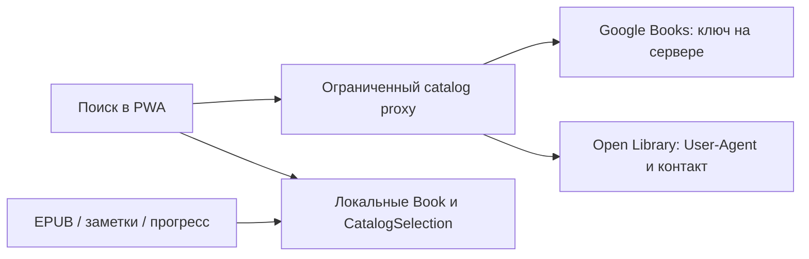

# Внешние каталоги · этап 09

Из библиотеки: **Найти в каталогах** → источник, название/автор/ISBN и русский/английский язык → результат → конкретное издание → пользовательские метаданные → новая книга или сопоставление. Авторы, описание, издательство, год/дата, ISBN и локальная обложка доступны для исправления. В карточке сохранённой книги обычное редактирование также меняет обложку и издательские поля. Свой EPUB/FB2 прикрепляется к этому же UUID через существующий импорт.

Результаты не являются пользовательскими книгами до сохранения. Для Open Library сначала показывается произведение, затем отдельные издания по 20 с пагинацией; ISBN/издательство/год/обложки берутся именно из выбранного издания, не из объединённого массива work. Если отдельного описания издания нет, описание произведения помечено как таковое, а источник сохраняется отдельно. Google volume — самостоятельная запись издания, детали дополнительно уточняются по volume ID. Нет N+1 запросов подробностей для каждого результата, фонового сбора каталога или загрузки полных текстов. Сквозной сценарий проверяется синтетическими CC0-ответами; фикстуры не добавляются в приложение при запуске.

## Официальные правила, проверенные 3 ноября 2026

- [Google Books: идентификация и поиск](https://developers.google.com/books/docs/v1/using): публичным запросам нужен API key или OAuth token. Авторизация пользователя для публичных volumes не требуется. Поиск поддерживает intitle/inauthor/isbn; [volumes.list](https://developers.google.com/books/docs/v1/reference/volumes/list) допускает до 40 результатов, Reedit запрашивает 10. Универсальное число суточных запросов не зашито: действующие квоты проверяются в [Google Cloud Console](https://docs.cloud.google.com/docs/quotas/view-manage), 403/429 прекращают повторные запросы.
- [Google Books branding](https://developers.google.com/books/branding): источники не смешиваются, порядок Google сохраняется, рядом с поиском/результатами используется официальный Powered by Google, у каждой записи — ссылка на Google Books. Никакого самостоятельного копирования/перерисовки логотипа. Правила [Books ToS](https://developers.google.com/books/terms) и [общие API ToS](https://developers.google.com/terms) включают ограничения постоянного копирования содержимого, кэширования и платного использования; включение ключа не даёт права зеркалировать каталог.
- [Open Library API](https://openlibrary.org/developers/api): человеческие поисковые запросы, кэширование, отсутствие scraping/bulk harvesting; это не инфраструктура для высоконагруженного коммерческого backend. Без идентификации — 1 запрос/с; с именем приложения и контактным email в User-Agent — 3 запроса/с. Контакт передаёт сервер, браузер не подделывает запрещённый User-Agent. Перед регулярной эксплуатацией владельцу следует зарегистрировать use-case по ссылке из официальной страницы и заполнить CATALOG_CONTACT.
- [Search API](https://openlibrary.org/dev/docs/api/search) возвращает work, выбранное по релевантности издание не означает все издания; Reedit использует отдельный [Work/Edition API](https://openlibrary.org/dev/docs/api/books). `lang` — предпочтение языка, не гарантия языка всех изданий. Пользователь видит язык выбранного издания. В запросах перечислены нужные fields, без `*`, availability и текстовых архивов.
- [Covers API](https://openlibrary.org/dev/docs/api/covers): не обходить обложки массово; CoverID/OLID предпочтительны, прочие идентификаторы ограничены 100 запросами/IP за 5 минут. Здесь используются только CoverID с `default=false`: отсутствующая обложка даёт 404 вместо пустого placeholder. Копируется только обложка, выбранная пользователем для личной записи, не каталог изображений. [Каталожные данные Open Library](https://openlibrary.org/help/faq/using) отделены от прав на сами изображения.

Консервативное поведение Google: поиск/справочные описание и обложка доступны в интерфейсе, но полная копия API-ответа не пишется в IndexedDB. Сохраняются source/volume ID/ссылка и подтверждённые пользователем библиографические поля. Описание собственной записи вводится отдельно; локальную обложку пользователь выбирает из своего файла. Кнопки Google не маскируют бессрочное копирование под кэш. Для Open Library можно выбрать одну из обложек издания, сохранить её Blob и исходную выбранную каталожную запись отдельно от пользовательского текста. Если требуется постоянный офлайн-архив Google-описаний/картинок, сначала нужны соответствующие права/разрешение; этот этап их не предполагает.

## Почему появился сервер

Это объяснённое до реализации изменение первоначального «только frontend»: единственный Node-сервис отдаёт dist и ограниченные `/api/catalog/*`. Ключ Google — только серверная переменная, не VITE_, не настройка браузера, не localStorage/IndexedDB и не query из клиента. Авторизации, пользовательской БД, загрузки EPUB/FB2, синхронизации библиотеки и внешних запросов из читалки не добавлено. При недоступном proxy вся локальная библиотека продолжает работать. При пустом ключе Google отвечает 503 с понятным состоянием UI; Open Library работает отдельно без ключа.

Сервер — нативные node:http/fetch/fs, без новой зависимости. Только GET, фиксированные hosts/paths/параметры и проверенные ID; нет произвольного upstream URL, POST/upload или download/read endpoint. Обложки ограничены PNG/JPEG/WebP, MIME/сигнатурой и 2 МБ; клиент затем проверяет реальные размеры до 6000×6000 и сохраняет локальную копию. JSON тоже ограничен 2 МБ. Redirect разрешён только для картинок на ограниченные HTTPS-домены Google/Internet Archive, не на localhost/произвольный адрес. Ошибки upstream не отражают его тело или ключ в клиент. Cross-origin вызовы отклоняются; лимит 90 входящих запросов/мин на socket IP и очередь до 12 на источник защищают небольшой персональный сервис. Это не распределённая защита для публичного сервиса с большой нагрузкой.

Open Library на сервере: минимум 1100 мс между запросами без контакта или 400 мс с контактом; Google — 1000 мс. При пустом или некорректном контактном email применяется анонимный лимит. Метаданные/картинки одного источника используют общий gate. Retry-After (секунды или HTTP-date) и Google 403 ставят источник на cooldown без циклического retry. Таймаут upstream — 12 с, обрыв клиента отменяет запрос/ожидание. Клиент блокирует повторные запросы до Retry-After отдельно для каждого источника. Для ограничений production-проекта дополнительно настраиваются API restrictions и квоты ключа в Console.

Поисковый кэш только в памяти: до 60 ответов браузера и 80 ответов proxy. Open Library TTL — 10 минут; Google — не дольше разрешённого upstream Cache-Control с учётом Age, максимум 10 минут; no-store/no-cache/private не превращаются в общий серверный кэш. Устаревшие записи не выдаются. История поиска в IndexedDB не сохраняется. Debounce — 600 мс, составление IME не отправляет промежуточный запрос. AbortController и guard устаревшего ответа защищают смену текста/источника/страницы и закрытие панели. Офлайн можно использовать ещё действующий временный кэш; иначе показано объяснение и остаётся ручное добавление. Перезагрузка не обещает офлайн-поиск по всем внешним каталогам.

## Локальная модель и целостность

`CatalogProvider` — общий порт; `GoogleBooksProvider`/`OpenLibraryProvider` нормализуют недоверенный JSON в CatalogBook/CatalogEdition. HTML из описаний не исполняется, текст выводится React как текст. Work и edition имеют отдельные ID, описание и издательские сведения; Book хранит пользовательскую редакцию. `CatalogSelection` имеет собственный UUID, bookId, source, editionId, отдельные record/edition references, selectedCover и snapshot Open Library. У Google snapshot=null. Внешние ID/ISBN не подменяют UUID.

Схема **v7** только добавляет catalogSelections с уникальностью `[bookId+source+editionId]`; старые Book/Reading/Blob/позиции/аннотации не преобразуются. Optional Book.publisher/publishedDate не требуют backfill. Копия обложки скачивается и проверяется до транзакции. `saveCatalogBook` атомарно сохраняет Book, источник и начальное Reading только для новой записи. Отказ квоты откатывает всё. Повтор того же издания предупреждает по source+edition ID или корректному ISBN с учётом ISBN-10/13; одинаковое название само по себе не является основанием слияния.

При сопоставлении выбирается существующий UUID. По умолчанию меняется только список каталожных идентификаторов/связей: пользовательские метаданные сохраняются. Замена полей из формы требует отдельного выбора checkbox и явного сохранения. Reading, отзывы, оценки, BookFile, позиции и заметки не переносятся и не удаляются. expectedUpdatedAt отклоняет устаревшую форму, включая удалённую в другой вкладке книгу. Последующее ручное редактирование Book не меняет исходную каталожную запись. Удаление файла не затрагивает provenance; подтверждённое удаление Book удаляет её связи с каталогом вместе с самой книгой.

## Запуск и Railway

В разработке нужны два процесса:

1. `pnpm start` — сервер на 4174; dist для работы только API не обязателен.
2. `pnpm dev` — Vite с same-origin маршрутом `/api/catalog` на 127.0.0.1:4174.

Для локального задания переменных скопируйте `.env.example` в `.env` и запускайте сервер `node --env-file=.env --experimental-strip-types server/index.ts`, либо задайте переменные в окружении. `pnpm start` сам не загружает .env. Пустые GOOGLE_BOOKS_API_KEY/CATALOG_CONTACT не заменяются выдуманными секретом или адресом.

Минимальный Railway service: build `pnpm install --frozen-lockfile && pnpm build`, start `pnpm start`, Node с поддержкой встроенного TS stripping (проверено на Node 24). Сервис слушает 0.0.0.0 и Railway PORT. GOOGLE_BOOKS_API_KEY и настоящий CATALOG_CONTACT задаются в [Variables](https://docs.railway.com/variables), команды — в [Build Configuration](https://docs.railway.com/builds/build-configuration). Нужны включённый Books API, ограничение ключа этим API и приемлемая проектная квота. Пользовательского server volume/БД нет. При обновлении сохраняйте origin приложения: IndexedDB другого домена недоступна прежней странице, хотя сама база не удалена. Этот этап не выполняет deployment и не получает доступ к Railway/Google Console.

## Проверки и ручная приёмка

Unit/integration: нормализация источников, ISBN, ссылки и языки конкретного издания; отсутствие HTML/полных текстов; TTL/отмена/429; повтор, независимая пользовательская редакция, явное сопоставление без потери истории, устаревшие записи, миграция v6 с Blob, квота/откат. Реальный локальный HTTP proxy проверяется с фиктивным upstream: allowlist, SSRF/redirect/upload/download запреты, server-only key, идентификация, Age/no-store, cooldown и отсутствие ключа.

E2E: выбор русского издания и альтернативной обложки → исправление метаданных/своей обложки → прикрепление EPUB к тому же UUID → reload; повторное издание и отзыв; debounce, поздний ответ, офлайн и ручное добавление; Google attribution, недоступный ключ и отсутствие сохранённого API snapshot. CC0-ответы из tests/fixtures/catalog.ts обозначены как синтетические. Отдельный живой запрос Open Library на русском успешно нашёл «Преступление и наказание»; реальный Google-запрос без предоставленного серверного ключа не выполнялся. Production smoke-test проверяет dist/asset=200 и Google без ключа=503.

Вручную на iPhone: поиск русской/английской книги и ISBN при настоящем proxy, пагинация изданий, реальные картинки/ошибки обложки, клавиатура и прокрутка панели на 320px, отсутствие сети и смена источника, повторное открытие библиотеки и своего EPUB. Для Google после настройки ключа — проверить действующую квоту, отсутствие ключа в клиентском bundle/ответах и корректную атрибуцию. WebKit текущего окружения не подтверждает Safari-сохранение Blob (известное ограничение development.md). Service Worker/офлайн-загрузка оболочки остаются отдельным этапом.

Файлы этапа: `src/domain/catalog.ts`, `src/infrastructure/catalog/*`, `src/services/catalog.ts`, `src/features/catalog/*`, `server/catalog-proxy.ts`, `server/index.ts`, `.env.example`; изменены модель/правила/репозитории/схема/LocalStore, library service/editor/view/Library, App/main, vite.config.ts, tsconfig.json, package scripts, gitignore и документация. Тесты — catalog.test.ts, catalog-proxy.test.ts, e2e/catalog.spec.ts, fixtures/catalog.ts; future-schema тест перенесён на v8.
