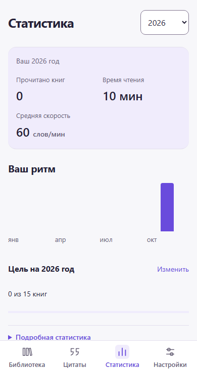

# Компактный мобильный Reedit

Настоящие снимки приложения в Chromium с мобильным viewport 390×740 и 320×740 CSS px. Физический iPhone и панели Safari не снимались. В отдельной тестовой базе созданы синтетические EPUB, обложки CC0 и валидные события чтения; в продукте никакие демонстрационные данные не добавляются.

| Состояние                              | 390 CSS px                            | 320 CSS px                            |
| -------------------------------------- | ------------------------------------- | ------------------------------------- |
| Пустая библиотека                      | [Снимок](390/library-empty.png)       | [Снимок](320/library-empty.png)       |
| Наполненная библиотека                 | [Снимок](390/library-filled.png)      | [Снимок](320/library-filled.png)      |
| Нет активности                         | [Снимок](390/statistics-empty.png)    | [Снимок](320/statistics-empty.png)    |
| Есть активность                        | [Снимок](390/statistics-filled.png)   | [Снимок](320/statistics-filled.png)   |
| Настройки                              | [Снимок](390/settings.png)            | [Снимок](320/settings.png)            |
| Тёмная тема                            | [Снимок](390/settings-dark.png)       | [Снимок](320/settings-dark.png)       |
| Текст 200%, прокрутка к нижним строкам | [Снимок](390/settings-large-text.png) | [Снимок](320/settings-large-text.png) |

## Пять состояний на 390 px

### Пустая библиотека

### Наполненная библиотека

### Пустая статистика

### Наполненная статистика

### Настройки

