# REEDIT · тёплая бумага

Снимки от 9 ноября 2026 года сделаны в Chromium с размерами viewport 320 × 780, 390 × 780 и 1440 × 960 CSS px. Использованы одинаковые синтетические книги, EPUB и обложки. Снимки «До» получены перед изменениями интерфейса. Снимки библиотеки показывают верх полки в каждом размере.

## Выбор направления

| Направление        | Полка, 320 px                                    | Читалка, 320 px                                     |
| ------------------ | ------------------------------------------------ | --------------------------------------------------- |
| Бумага и терракота | 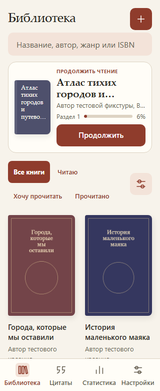 | 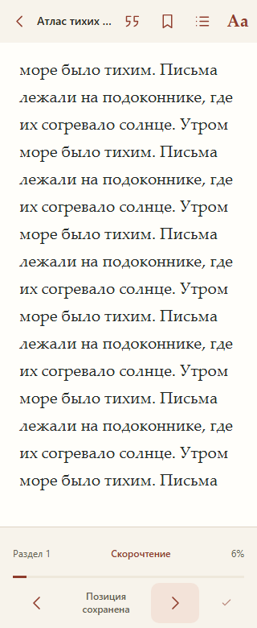 |
| Прохладные чернила | 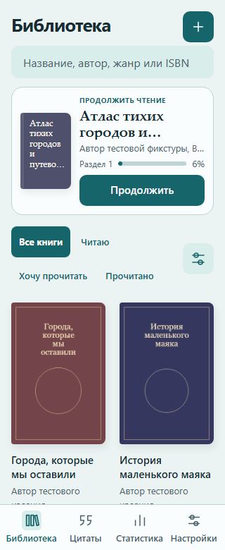  | 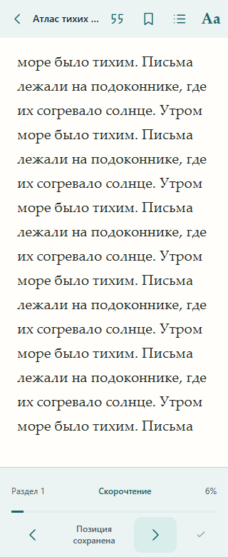  |

В первом варианте тёплый нейтральный фон поддерживает книжный характер, а контрастная терракота выделяет основные действия. Во втором плотный гротеск и прохладные поверхности дают более инструментальный характер. Выбрана бумага. Макеты выше используют рабочую библиотеку и ридер до изменения элементов управления. [Оба направления при 390 px](directions/390).

## До и после

### 320 CSS px

| Состояние    | До                           | После                          |
| ------------ | ---------------------------- | ------------------------------ |
| Пустая полка | 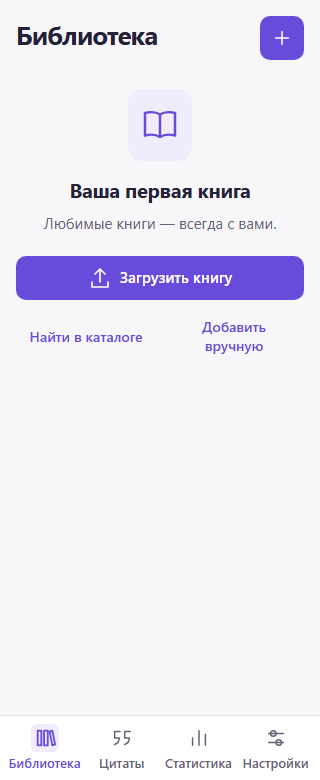  | 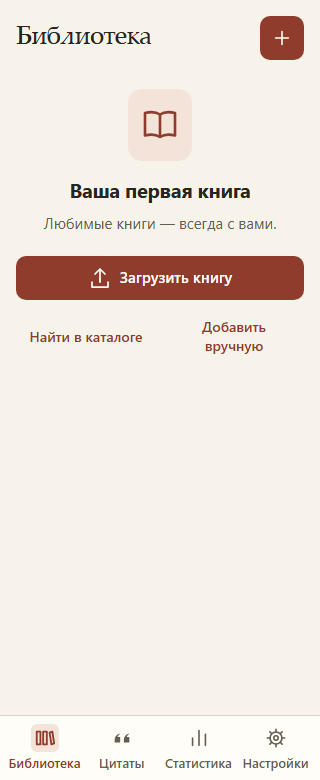  |
| Одна книга   | 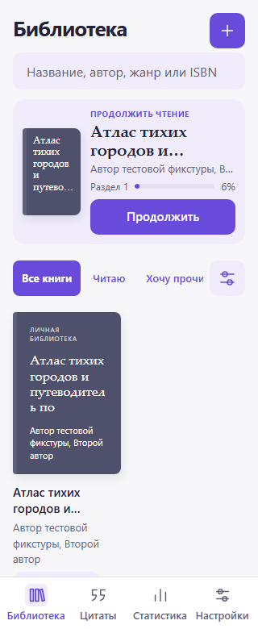    | 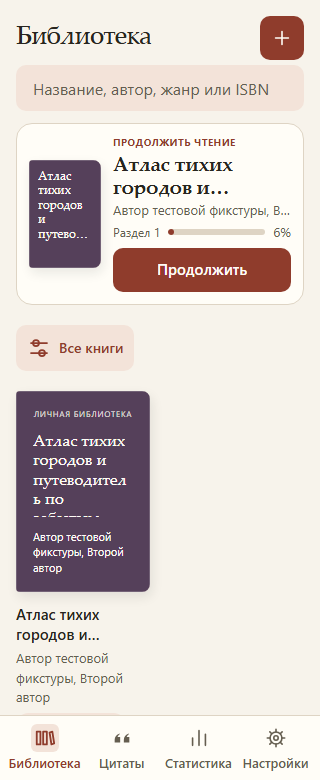    |
| Девять книг  | 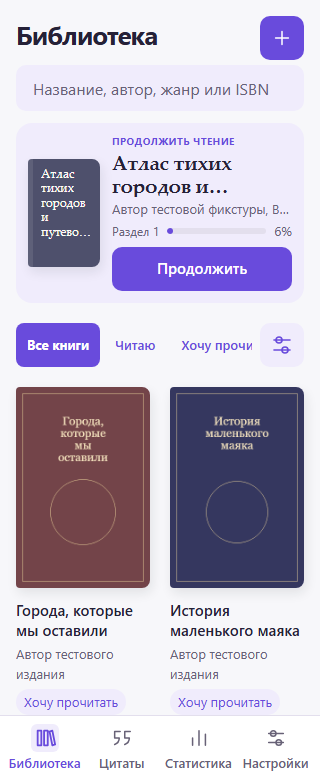  | 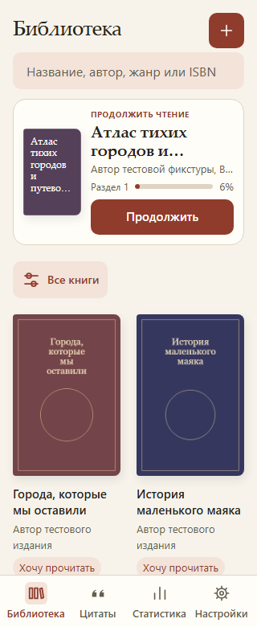  |
| Чтение       | 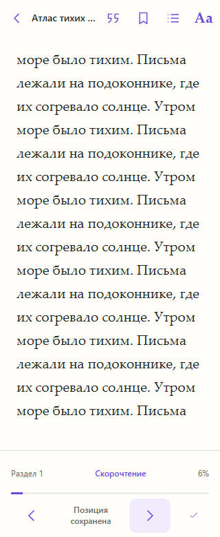 | 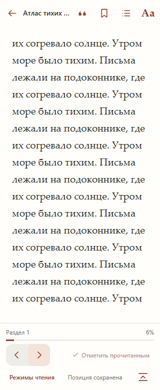 |

### 390 CSS px

| Состояние    | До                           | После                          |
| ------------ | ---------------------------- | ------------------------------ |
| Пустая полка | 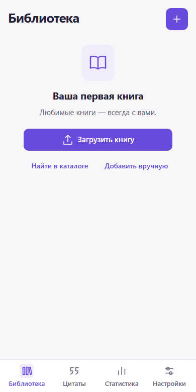  | 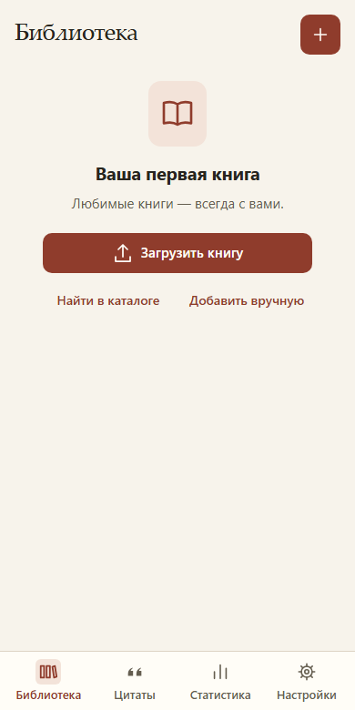  |
| Одна книга   | 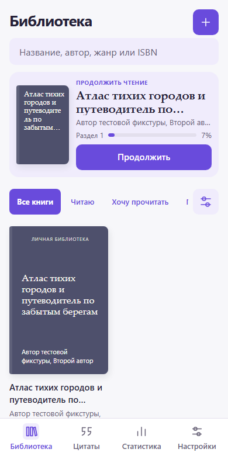    | 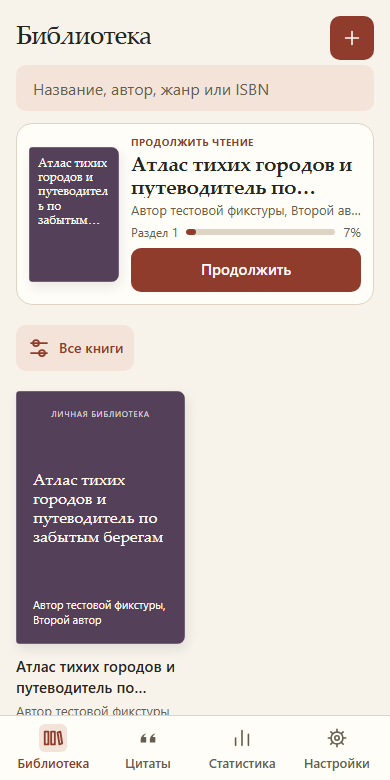    |
| Девять книг  | 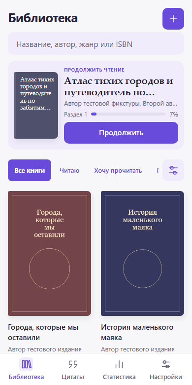  | 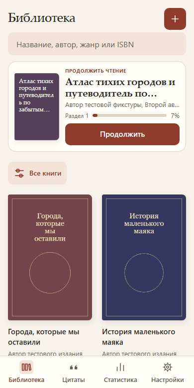  |
| Чтение       | 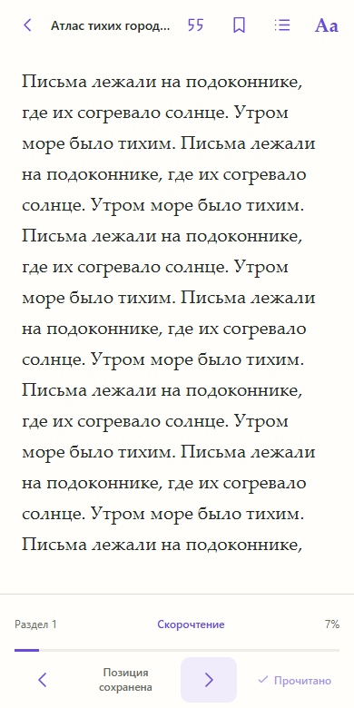 | 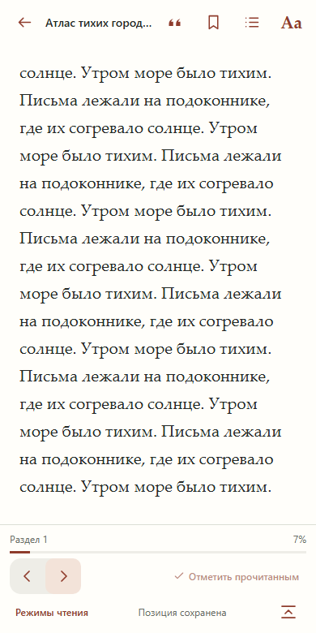 |

### 1440 CSS px

| Состояние    | До                               | После                           |
| ------------ | -------------------------------- | ------------------------------- |
| Пустая полка | [Снимок](before/1440/empty.png)  | [Снимок](after/1440/empty.png)  |
| Одна книга   | [Снимок](before/1440/one.png)    | [Снимок](after/1440/one.png)    |
| Девять книг  | [Снимок](before/1440/shelf.png)  | [Снимок](after/1440/shelf.png)  |
| Чтение       | [Снимок](before/1440/reader.png) | [Снимок](after/1440/reader.png) |

## Управление на 320 CSS px

Значки показаны в масштабе CSS. Плитки имеют размер 44 × 44 px.

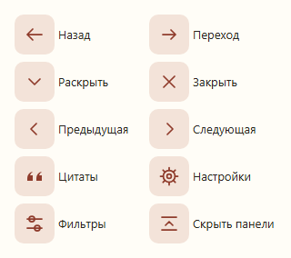

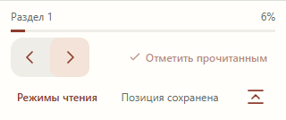

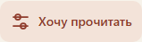

## Остальные экраны

- [Импорт EPUB](after/390/import.png).
- [Выделение](after/390/reader-selection.png), [цитаты](after/390/quotes.png).

- [Оглавление](after/390/contents.png), [Aa](after/390/appearance.png), [сепия](after/390/reader-sepia.png).
- [По одному слову](reader-words.png), [с подсветкой текста](after/390/reader-guided.png).
- [Статистика](after/390/statistics.png), [настройки](after/390/settings.png), [тёмная библиотека](after/390/shelf-dark.png).

## Проверка

184 модульных и интеграционных теста прошли. Основной прогон Chromium дал 132 успешных сценария, три падения и один пропуск. Два падения пришлись на сценарий редактирования цитаты со старым селектором. В третьем тесте повторного импорта FB2 открытая карточка книги перекрыла кнопку добавления. Сценарии обновлены под новую навигацию. Повторный прогон остановлен по просьбе пользователя.

В production прошли пять проверок PWA и отдельный повтор холодного офлайн-запуска из сохранённого профиля. В первом прогоне холодный запуск достиг тайм-аута. Сборка прошла после последних правок.

В браузере проверены EPUB → чтение → цитата → переход к месту, повторное открытие позиции, переключение тем, имитация клавиатуры и мобильные размеры. Финальная перестройка полки при 200% и имитация нижнего отступа 34 px остались без повторной проверки. Физический iPhone не использовался.
